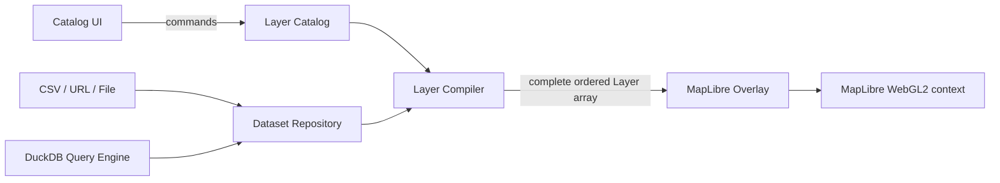

# Map Workspace Design

## AI Notes

> These constraints apply to implementation work in this feature.

- Prioritize simplicity, readability, and clarity. Keep changes low-churn.
- Keep styling minimal. Use nested CSS only where it expresses structural semantics.
- This project uses Solid 2. Import `createStore` from `solid-js`; do not introduce Solid 1 patterns such as `solid-js/store` or `unwrap`.
- Use Solid 2's two-phase `createEffect(compute, effect)` API. Reactive reads belong in the compute callback; imperative MapLibre and deck.gl writes belong in the effect callback.
- Keep persisted configuration, loaded datasets, and runtime renderer objects separate.
- Do not store MapLibre maps, overlays, deck.gl layers, `AbortController`s, errors, or large parsed datasets in serializable catalog configuration.
- Use stable layer IDs. Always send the complete ordered layer array to `MapLibreOverlay.setProps`; deck.gl reconciles matching layers by ID.
- Preserve hidden layers with `visible: false`. Remove a layer from the array only when deleting it.
- Prefer typed deck.gl constructors. Do not add `@deck.gl/json` until importing or exporting user-authored deck.gl JSON is a confirmed requirement.
- Start with object-row datasets. Do not prioritize workers, Arrow conversion, or binary deck.gl attributes until representative profiling shows a parsing, memory, or attribute-generation bottleneck.
- Add packages used by source code as direct dependencies. Do not depend on transitive packages.

## Goal

Build a lightweight Kepler-style map workspace composed of independent features:

- [x] Map engine
- [x] Layer catalog
- [ ] Dataset repository
- [ ] Layer compiler
- [ ] Catalog UI
- [ ] DuckDB query engine (future)

A parent workspace owns and composes these features. The map engine renders layers but does not own catalog business logic.

## Architecture

```text
MapWorkspace
|-- MapEngine
|   `-- MapLibreMap + MapLibreOverlay lifecycle
|-- LayerCatalog
|   |-- Serializable layer definitions
|   |-- Selection and ordering
|   `-- Add, remove, toggle, and update commands
|-- DatasetRepository
|   |-- loaders.gl ingestion
|   |-- Loading status, errors, and cancellation
|   `-- Parsed-data cache
|-- LayerCompiler
|   `-- Layer definitions + datasets -> deck.gl Layer[]
|-- LayerCatalogPanel
|   `-- Catalog list and type-specific controls
`-- QueryEngine
    `-- DuckDB datasets and views (future)
```



## Ownership

### Map Workspace

The composition root owns catalog and dataset state. It passes compiled layers to the map engine and state/actions to the catalog UI.

### Map Engine

Owns only runtime mapping resources:

- Map container element
- `MapLibreMap`
- `MapLibreOverlay` with `interleaved: true`
- Map controls and lifecycle cleanup
- Theme-driven basemap style

It accepts a complete deck.gl layer array and applies it with `overlay.setProps({ layers })`.

### Layer Catalog

Owns serializable user intent:

- Layer definitions
- Layer order; array order is render order
- Visibility
- Display properties such as opacity, colors, and radius
- Selected layer ID

Expose explicit commands rather than a generic `updateProperty(key, any)` API. Commands should preserve schema validation and make call sites discoverable.

### Dataset Repository

Owns non-serializable and potentially large data state:

- Source descriptors
- Parsed rows or binary tables
- Loading status and errors
- Request cancellation
- Cache identity and disposal

Use `@loaders.gl/csv` for CSV parsing. If using the loaders.gl `load()` API directly, add `@loaders.gl/core` as a direct dependency. A deck.gl layer may alternatively load a URL using `data: url` and `loaders: [CSVLoader]`; use the repository when the UI, multiple layers, or DuckDB need shared access to the data.

The initial implementation uses object rows because they are easy to validate, inspect, query, and map with deck.gl accessors. Keep the repository and compiler contracts independent of that representation so a measured hot path can later use streamed Arrow batches or external binary attributes without changing catalog state or UI code.

Binary loading is an explicit optimization, not automatic loaders.gl behavior. `CSVArrowLoader` can produce columnar batches, and typed arrays can be transferred from a worker without serialization, but the application must still map columns to deck.gl's `data.attributes` contract. CPU-side arrays and GPU buffers occupy separate memory.

### Layer Compiler

The compiler is a pure boundary from application state to renderer descriptions:

```ts
function compileLayers(
  definitions: readonly LayerDefinition[],
  datasets: DatasetLookup,
): Layer[];
```

Use typed constructors and stable IDs. Creating new layer descriptions is expected; deck.gl reuses the prior layer's internal GPU state when type and ID match.

## State Models

Use discriminated unions instead of `[key: string]: any`.

```ts
type LayerDefinition =
  | ScatterplotLayerDefinition
  | GeoJsonLayerDefinition
  | ArcLayerDefinition;

type BaseLayerDefinition = {
  id: string;
  name: string;
  datasetId: string;
  visible: boolean;
  opacity: number;
};

type ScatterplotLayerDefinition = BaseLayerDefinition & {
  type: "scatterplot";
  position: { longitudeColumn: string; latitudeColumn: string };
  radius: number;
  fillColor: readonly [number, number, number, number];
};

type CatalogState = {
  layers: LayerDefinition[];
  selectedLayerId?: string;
};

type DatasetData =
  | {
      kind: "rows";
      rows: readonly Record<string, unknown>[];
    }
  | {
      kind: "binary";
      length: number;
      attributes: BinaryAttributes;
    };

type DatasetState = {
  id: string;
  status: "idle" | "loading" | "ready" | "error";
  data?: DatasetData;
  error?: string;
};
```

`BinaryAttributes` is a repository-owned abstraction over the typed-array attribute descriptors accepted by deck.gl. It is an extension point, not part of the first implementation.

Persist only catalog definitions and dataset source descriptors. Validate restored state at the persistence boundary before it enters the catalog.

## Reactive Pipeline

Solid tracks the serializable inputs and performs the overlay write in the effect phase:

```ts
createEffect(
  () => [mapOverlay(), compileLayers(catalog.layers, datasets)] as const,
  ([overlay, layers]) => overlay?.setProps({ layers }),
);
```

The real implementation may compute a snapshot or memo first if required by Solid's store tracking semantics. It must read every reactive property that should invalidate compilation inside a tracking scope. Never strip tracking before traversing those properties.

For rapid controls such as sliders, first use direct updates and measure. Add throttling or interaction-local preview state only if diagnostics show a real performance problem.

## Catalog Controls

Control metadata is useful, but it must be typed by layer kind. Each entry should define:

- Property key
- Label
- Control type
- Bounds and step where applicable
- Read and write behavior
- Optional formatter or validation

Avoid assuming every deck.gl prop should be editable. Start with an explicit supported subset for each layer type.

## Error Handling

- Dataset failures belong to the dataset entry and remain visible to the catalog UI.
- Removing a loading dataset aborts its request.
- Removing a layer does not remove a shared dataset until no remaining layer references it, unless the user explicitly removes the dataset.
- A compiler error should identify the layer ID and omit or disable only that layer, not break the map engine.
- Map and overlay cleanup remains owned by the map engine.

## Implementation Plan

Execute these phases in order. Keep each phase independently testable.

### Phase 1: Extract the Map Engine

1. Move MapLibre and `MapLibreOverlay` lifecycle code out of the catalog UI.
2. Give the engine one input: `layers: readonly Layer[]` or an accessor with equivalent ownership.
3. Preserve theme switching, controls, worker setup, interleaved rendering, and cleanup.
4. Verify map creation/disposal and overlay layer updates.

### Phase 2: Add Typed Catalog State

1. Define `BaseLayerDefinition` and one initial `ScatterplotLayerDefinition`.
2. Create catalog state with explicit `addLayer`, `removeLayer`, `toggleVisibility`, `moveLayer`, and selection commands.
3. Move the hardcoded demo configuration into catalog initial state.
4. Test ordering, visibility, deletion, and stable IDs without rendering a map.

### Phase 3: Add the Dataset Repository

1. Define source descriptors separately from parsed data.
2. Load CSV as object rows through `CSVLoader`, with status, error, and cancellation state.
3. Define the dataset lookup contract consumed by the future compiler.
4. Seed the existing demo rows through the repository rather than catalog state.
5. Test success, malformed input, cancellation, deletion, and shared datasets.

### Phase 4: Add the Layer Compiler

1. Compile the scatterplot definition and resolved `datasetId` into `ScatterplotLayer`.
2. Keep the compiler dispatching on `DatasetData.kind`, but implement only `"rows"` initially.
3. Retain hidden layers with `visible: false` and feed the complete array to the map engine.
4. Test type mapping, ordering, accessors, visibility, and unchanged IDs.

### Phase 5: Build the Catalog UI

1. Render layer rows from catalog state.
2. Add visibility, selection, delete, and ordering controls.
3. Render a small typed control set for the selected layer.
4. Keep UI components free of MapLibre and overlay calls; they invoke catalog commands only.

### Phase 6: Persistence

1. Define a versioned workspace schema.
2. Validate on import and migrate older versions explicitly.
3. Persist catalog definitions and source descriptors only.
4. Reload datasets and recompile layers when restoring a workspace.

### Phase 7: DuckDB Integration

1. Treat DuckDB query results as another dataset source.
2. Keep query definitions serializable and result tables runtime-owned.
3. Reuse the same compiler and catalog contracts; do not add DuckDB knowledge to the map engine.

## Deferred Decisions

- Add `@deck.gl/json` only for user-authored deck.gl JSON interoperability. Its schema uses `@@type`, and converted output must be runtime-validated because `JSONConverter.convert()` returns `unknown`.
- Add a `"binary"` dataset implementation only after representative benchmarks identify row parsing, memory use, or main-thread attribute generation as a bottleneck.
- Choose persistence storage only after the versioned schema exists.
- Add worker-based parsing, Arrow batches, or external deck.gl attributes only after profiling demonstrates the need; these optimizations require explicit adapters and are not enabled merely by using loaders.gl.

## Historical RFC

See `./rfc-layer-catalog.md` for the earlier exploration. It is not implementation guidance; the AI notes and constraints above supersede it.